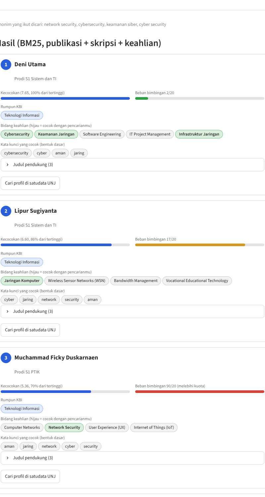
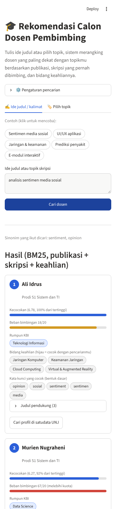

# Rekomendasi Calon Dosen Pembimbing (Topik 4)

Tugas Project **Temu Kembali Informasi**, Prodi Sistem dan Teknologi Informasi, Universitas Negeri Jakarta (UNJ).

Sistem menerima ide judul/topik skripsi lalu merangking dosen yang paling sesuai, lengkap dengan skor,
penjelasan (kata kunci yang cocok dan judul pendukung), serta beban bimbingan dosen.

## Anggota dan pembagian tugas
| Anggota | Peran | Bagian utama |
|---|---|---|
| Muhammad Naufal Athallah | Data engineer & pre-processing | Pengumpulan data, anonimisasi, `src/preprocess.py`, `data_collection/` |
| Naufal Hibatullah Thariq | Core IR developer | `src/index.py`, `src/ranking.py`, `src/recommender.py` |
| Naila Shabrina | Evaluation & testing | Query uji + penilaian relevansi, `src/evaluate.py`, failure analysis |
| Muhammad Naufal Razan | Full-stack & integrasi | `app.py`, README, integrasi repo, video demo, laporan akhir |

Setiap anggota wajib memahami dan mampu menjelaskan seluruh kode.

## Fitur
- Inverted index buatan sendiri (tanpa library pencarian siap pakai).
- Dua model ranking: **TF-IDF (cosine)** dan **BM25** (k1=1.5, b=0.75).
- Tiga representasi profil dosen: **publikasi saja**, **gabungan** (publikasi + judul skripsi yang dibimbing), dan **gabungan + keahlian** (ditambah bidang keahlian dan rumpun KBI dari data dosen).
- **Pencarian dengan kata kunci**: tab "Pilih topik" (topik diambil dari bidang keahlian dosen) dan **perluasan sinonim Indonesia-Inggris** (`src/expand.py`), sehingga query tidak harus sama dengan judul skripsi.
- Kartu dosen menampilkan **prodi, rumpun KBI, bidang keahlian** (yang cocok diberi warna), beban bimbingan, dan tautan ke pencarian pegawai satudata UNJ.
- Filter prodi dan rumpun KBI; antarmuka ramah HP; siap di-deploy sebagai web publik (`DEPLOY.md`).
- Penjelasan rekomendasi: kata kunci yang cocok dan judul pendukung.
- Bonus: **pertimbangan beban bimbingan** (slider; skripsi dibimbing dibanding kuota) dan **tampilan perbandingan berdampingan** profil publikasi vs gabungan.

## Tampilan
| Laptop | HP |
|---|---|
|  |  |

## Struktur repo
| Komponen | File |
|---|---|
| Pre-processing (normalisasi, tokenisasi, stopword, stemming Sastrawi) | `src/preprocess.py` |
| Inverted index (postings, df, panjang dokumen) | `src/index.py` |
| Model ranking TF-IDF dan BM25 | `src/ranking.py` |
| Profil dosen, ranking, penjelasan, beban bimbingan | `src/recommender.py` |
| Perluasan query (sinonim ID-EN) | `src/expand.py` |
| Evaluasi hold-out (Success@1, Success@3, MRR) dan ablasi fitur | `src/evaluate.py` (`--ablasi`) |
| Grafik evaluasi | `src/plot_evaluasi.py` |
| Antarmuka web | `app.py` (Streamlit) |
| Pengumpulan dan penggabungan data | `data_collection/` |
| Data siap pakai | `data/` |
| Query uji dan hasil evaluasi | `eval/` |

## Cara menjalankan
Butuh Python 3.10+ .
```bash
pip install -r requirements.txt
streamlit run app.py          # buka http://localhost:8501 (untuk web publik: lihat DEPLOY.md)
python -m src.evaluate        # hasil di folder eval/
```
Di sidebar aplikasi: pilih model (BM25/TF-IDF), profil (gabungan/publikasi), jumlah hasil, bobot beban bimbingan,
dan centang **Bandingkan profil berdampingan** untuk melihat dua daftar sekaligus.

## Data
| Berkas | Isi | Kolom |
|---|---|---|
| `data/lecturers.csv` | 24 dosen pembimbing | `id, nama, bidang, kuota, pakar, rumpun_kbi` |
| `data/publications.csv` | 328 judul publikasi dosen | `lecturer_id, judul, tahun` |
| `data/theses.csv` | 592 baris skripsi-pembimbing (310 skripsi) | `thesis_id, judul, lecturer_id, tahun` |

**Sumber (informasi publik):**
- Skripsi dan nama pembimbing: Repositori UNJ (repository.unj.ac.id), program studi S1 Sistem dan Teknologi Informasi dan S1 PTIK.
- Publikasi dosen: Scopus, Google Scholar, Garuda (garuda.kemdiktisaintek.go.id), dan SINTA (sinta.kemdiktisaintek.go.id). Data publikasi diperbarui **19-20 November 2026**: judul di luar keilmuan komputer dibuang manual, judul ganda per dosen dihapus, dan satu dosen (Rauhil Fahmi, belum punya skripsi di repositori, beban 0) ditambahkan. Berkas sumber: `data_collection/out/Dataset_Publikasi_Dosen.xlsx` (satu sheet per dosen, 24 dosen); diubah menjadi CSV dengan `python data_collection/import_dataset_xlsx.py`, lalu `python data_collection/build_dataset.py`.
- Tanggal pengambilan: **11-12 November 2026**.

**Etika dan privasi:** nama mahasiswa dan NIM **tidak** disimpan. Data hanya memuat judul skripsi, tahun, dan nama dosen (informasi publik).
Pengambilan data dari repositori memakai jeda antar-permintaan dan mengikuti robots.txt. Cara membuat ulang data: `data_collection/README.md`.
Periksa data dengan `python data_collection/check_data.py`.

**Catatan penting data:**
- **Kuota**, **bidang keahlian** (`pakar`), dan **rumpun KBI** berasal dari berkas `dosen.csv` (`data_collection/out/dosen.csv`), diubah menjadi `lecturers_info.csv` dan digabung oleh `build_dataset.py`. Kuota semua dosen di berkas itu bernilai 20.
- Semua 24 dosen punya publikasi (Rauhil Fahmi belum punya skripsi, bebannya 0). Beberapa dosen publikasinya sedikit (mis. Vannisa Irma Dewi dan Via Tuhamah Fauziastuti masing-masing satu judul), sehingga profilnya lemah.
- Sebagian judul publikasi berbahasa Inggris sedangkan query berbahasa Indonesia; kata yang sama tidak otomatis cocok.

## Evaluasi
Metode: judul skripsi lama dijadikan query; hasil **benar** bila salah satu pembimbing asli muncul di 3 besar.
Skripsi uji **dikeluarkan dari profil dosen** (hold-out) agar tidak terjadi kebocoran.
Query: **30 judul** yang disusun dan dinilai secara manual (`eval/query_uji_manual.csv`), termasuk **5 baris dinilai penilai di luar kelompok**.

| Profil | Model | Success@1 | Success@3 | MRR |
|---|---|---|---|---|
| publikasi | TF-IDF | 0.100 | 0.400 | 0.314 |
| publikasi | BM25 | 0.133 | 0.433 | 0.330 |
| gabungan | TF-IDF | 0.200 | 0.400 | 0.402 |
| gabungan | BM25 | **0.333** | **0.467** | **0.481** |

Profil gabungan dengan BM25 paling baik. Hasil lengkap: `eval/hasil_evaluasi.csv`; query yang gagal: `eval/query_gagal.json`.

**Fitur pencarian kata kunci (ablasi, BM25, 30 query yang sama):**

| Konfigurasi | Success@1 | Success@3 | MRR |
|---|---|---|---|
| gabungan (acuan) | 0.333 | 0.467 | 0.481 |
| gabungan + sinonim | 0.333 | 0.567 | 0.499 |
| gabungan + keahlian | 0.333 | 0.500 | 0.487 |
| gabungan + keahlian + sinonim | 0.267 | 0.633 | 0.465 |

Kedua fitur menaikkan Success@3 tanpa merusak hasil, tetapi satu query setara 3,3 poin dan query uji berupa judul lengkap, bukan kata kunci pendek, jadi tabel ini terutama bukti bahwa fitur baru tidak merugikan. Hasil lengkap: `python -m src.evaluate --ablasi` -> `eval/hasil_ablasi.csv`.

## Keterbatasan
- Dataset kecil (24 dosen); hasil evaluasi belum mewakili seluruh dosen.
- Dosen dengan profil besar cenderung mendominasi karena cocok pada kata umum.
- Kamus sinonim Indonesia-Inggris (`src/expand.py`) kecil dan ditulis tangan; istilah di luar kamus tidak diperluas.
- Kuota bimbingan sama (20) untuk semua dosen sesuai `dosen.csv`; beban dihitung dari skripsi yang ada di repositori, bukan jumlah bimbingan aktif.
- Kata kunci pada penjelasan rekomendasi selalu dihitung dari kontribusi BM25, walaupun pengguna memilih TF-IDF, sehingga bisa sedikit berbeda dari alasan ranking TF-IDF.
- Dosen dengan profil sangat kecil (mis. satu publikasi) bisa naik ke peringkat atas bila kata query kebetulan cocok.

## Penggunaan alat AI
Kelompok menggunakan Claude (Anthropic) untuk membantu pengerjaan proyek baik struktur kode maupun query, serta menulis skrip pengumpulan data. Seluruh keluaran AI ditinjau, diuji, dan disesuaikan oleh anggota kelompok. Setiap anggota akan tetap memahami dan wajib bisa menjelaskan seluruh kode dan hasil saat presentasi.

Data skripsi dikumpulkan dari halaman publik repositori UNJ untuk prodi Sistem dan Teknologi Informasi dan Pendidikan Teknik Informatika dan Komputer, periode 2024-2026 menggunakan script python lewat google collab. Pengambilan data mematuhi robots.txt situs bersangkutan, dengan jeda 1,5 detik antar permintaan agar tidak memberatkan server. Data yang disimpan hanya judul, tahun, dan nama dosen pembimbing. Data mahasiswa tidak disimpan maupun ditampilkan. Nama dosen pembimbing merupakan informasi publik yang tercantum di repositori. Sumber dan tanggal pengambilan data dicatat dalam README. Untuk data publikasi dosen diambil secara manual dari Google Scholar, Garuda, dan SINTA.
